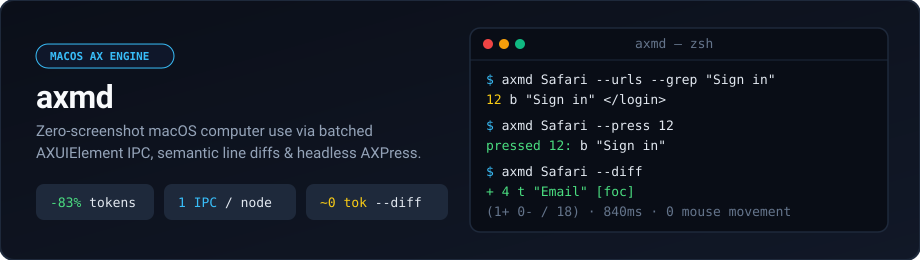

<div align="center">



<br/>

[](https://github.com/elix1er/axmd/actions/workflows/ci.yml)
[](axmd.swift)
[](axmd.swift)
[](LICENSE)

**Fast, token-minimal macOS computer use over the Accessibility (`AXUIElement`) tree.**  
One Swift file. Batched attribute IPC, index-free line diffs, and headless `AXPress` clicks.

</div>

---

## Why

Screenshot loops cost **1,500+ tokens per frame**, add 1–3s of vision latency per turn, and break whenever a window moves. Raw `AXUIElement` dumps avoid coordinate drift but dump **60+ KB of nested noise** (`AXGroup` wrappers, unlabeled icons, duplicate `AXStaticText` nodes, and 10+ Mach IPC calls per node).

`axmd` walks any macOS app's accessibility tree in a single batched IPC round-trip per node and prints **one line per interactive element**:

```text
12 b "Sign in"
13 l "Docs" </docs/getting-started>
14 t "Search..." ="axmd" [foc]
15 c "Remember me" [on]
```

## Benchmarks

1,587-node Safari web page on Apple Silicon:

| Method | Output Size | Est. Tokens | Latency | Moves Cursor |
| :--- | :---: | :---: | :---: | :---: |
| `osascript` (`entire contents`) | 1,160 KB | ~290,000 | >12.0 s | Yes |
| Unpruned AX tree dump | 63.4 KB | ~15,850 | 1.74 s | No |
| Screenshot loop (1080p) | PNG / WebP | ~1,500–3,000 | ~1.50 s | Yes |
| **`axmd` full snapshot** | **10.9 KB** | **~2,720** | **0.88 s** | **No** |
| **`axmd --diff` (delta)** | **290 B** | **~73** | **0.70 s** | **No** |
| **`axmd --grep` (lookup)** | **45 B** | **~12** | **0.70 s** | **No** |

## How It Works

- **Batched IPC (`AXUIElementCopyMultipleAttributeValues`):** Fetches all 13 attributes (`AXRole`, `AXSubrole`, `AXTitle`, `AXDescription`, `AXValue`, `AXEnabled`, `AXFocused`, `AXChildren`, `AXURL`, etc.) in one Mach message per node instead of 13.
- **Lazy Chromium Hydration (`AXManualAccessibility`):** Enables `AXManualAccessibility` only when not already set on the target PID so Chromium/Electron apps populate their web-content tree without adding sleep overhead on repeat calls.
- **Helper Process Filtering (`activationPolicy == .regular`):** Ignores renderer/GPU helper processes so app lookup by name never collides.
- **Shift-Resilient Diffs (`--diff`):** Caches the last snapshot per `<pid>-<root>-<window>-<mode>` and strips leading indices before diffing, so an inserted banner emits `+ 1 line` instead of invalidating every index below it.

## Build & Install

```bash
make            # swiftc -O axmd.swift -o axmd
make universal  # fat binary (arm64 + x86_64) via lipo
make install    # copies to /usr/local/bin/axmd
```

Or grab the universal binary from [Releases](https://github.com/elix1er/axmd/releases).

> **Permission:** Grant **Accessibility** to your terminal or agent host in **System Settings › Privacy & Security › Accessibility**.

## Usage

```bash
./axmd Safari --grep "Sign in"        # 12 b "Sign in"
./axmd Safari --press 12              # headless AXPress click
./axmd Safari --diff                  # + / - lines since last run
./axmd Safari --text --root webarea   # include static text inside page
./axmd Safari --type 14 "hello"       # focus & set text field value
```

```text
usage: axmd <app> [--root s] [--window s] [--text] [--grep s] [--urls] [--tree] [--diff] [--press i] [--type i txt]
```

| Flag | Description |
| :--- | :--- |
| `<app>` | App name (`"Google Chrome"`), bundle ID (`com.apple.Safari`), or PID |
| `--root <s>` | Start at first node matching role/subrole (`dialog`, `webarea`, `tabgroup`, `toolbar`) |
| `--window <s>` | Match window by title substring (default: focused window) |
| `--grep <s>` | Case-insensitive line filter (does not overwrite `--diff` cache) |
| `--diff` | Show only `+` added and `-` removed lines vs previous snapshot |
| `--press <i>` | Trigger `AXPress` (or `AXConfirm`) on element `<i>` (exits non-zero on failure) |
| `--type <i> <s>` | Focus element `<i>` and set `AXValue` to `<s>` |
| `--text` | Include `AXStaticText` nodes (default: interactive + headings only) |
| `--urls` | Append `<href>` to links (relative path for same-host URLs) |
| `--tree` | Indent by tree depth |
| `--max <n>` | Max nodes visited (default: `3000`) |

**Roles:** `b` button · `l` link · `t` textfield · `c` checkbox · `r` radio · `p` popup · `m` menuitem · `s` slider · `tab` · `h` heading · `x` text · `dlg` dialog  
**Flags:** `sel` selected · `foc` focused · `off` disabled · `open` expanded · `on` / `mixed` checked

## Agent Skill

[`skills/axmd-computer-use/`](skills/axmd-computer-use/SKILL.md) provides a portable `SKILL.md` and lock-safe batch runner ([`loop.sh`](skills/axmd-computer-use/scripts/loop.sh)):

```bash
cp -R skills/axmd-computer-use ~/.codex/skills/    # Codex
cp -R skills/axmd-computer-use ~/.claude/skills/   # Claude Code
cp -R skills/axmd-computer-use .agents/skills/     # Antigravity / Gemini
```

## License

[MIT](LICENSE)
